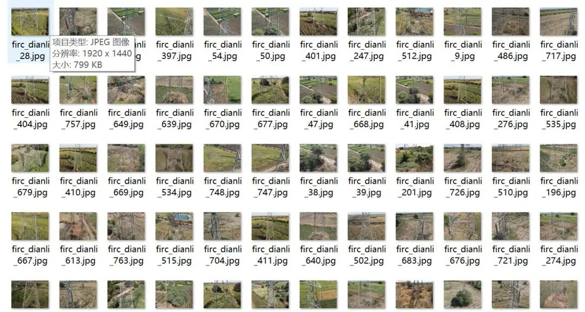
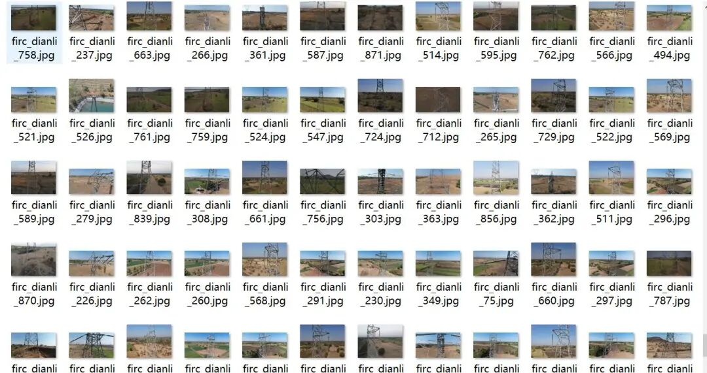
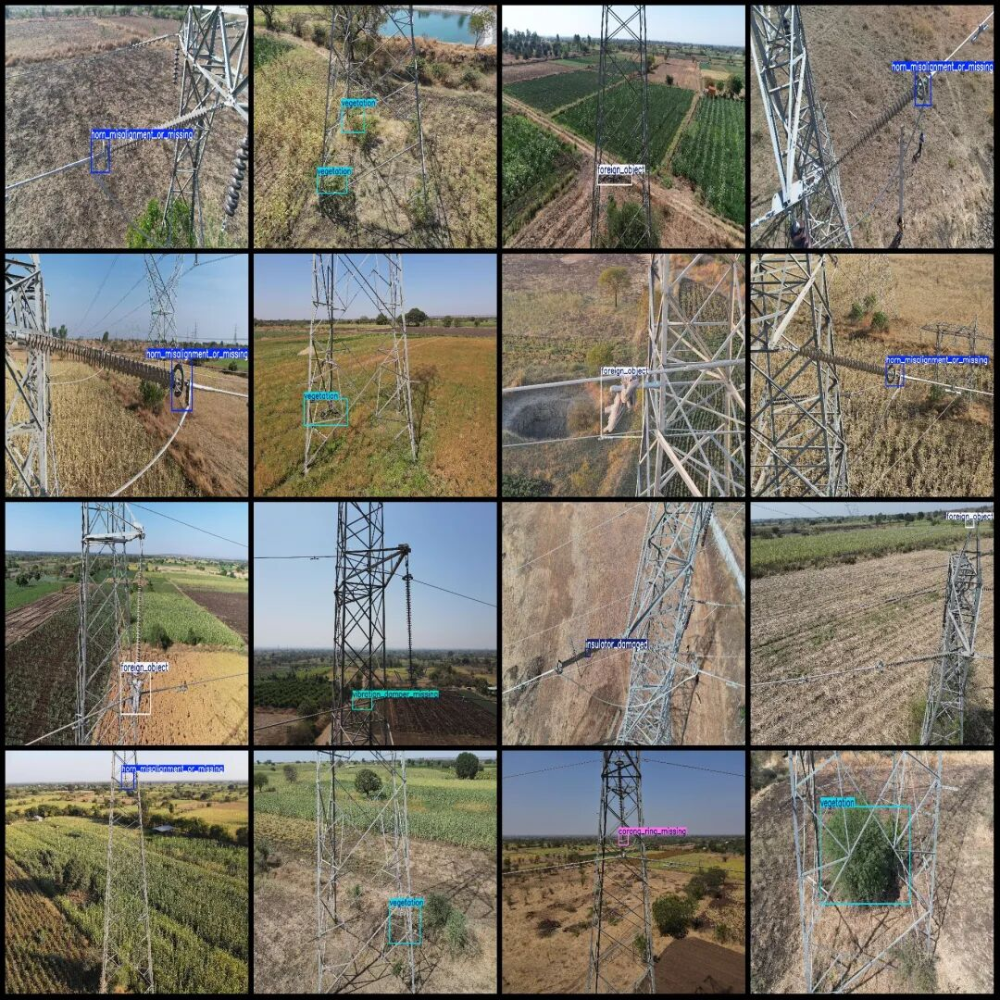
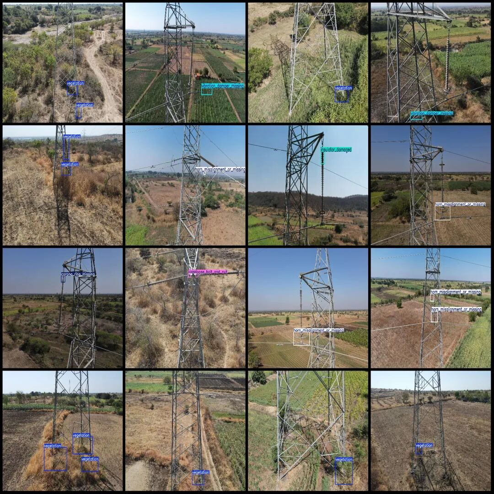

# Power Scene: Electricity Inspection Data Set - Misaligned Grounding Ring, Loose Bolts, Vibration Dampener Absent, Missing Nuts - VOC+YOLO Format - 916 Categories

Dataset format: Pascal VOC format + YOLO format (txt file without split path, only contains jpg images and corresponding VOC format xml files and yolo format txt files)

Number of images (number of jpg files): 916

Number of annotations (number of xml files): 916

Number of annotations (number of txt files): 916

Labeling category count: 9

Label category names (Note that the order of labels in the YOLO format does not correspond to this, but is based on the classes.txt file in the labels folder): ["conducting_wire_misconnection", "corona_ring_missing", "earth_wire_faulty", "foreign_object", "horn_misalignment_or_missing", "insulator_damaged", "loose_bolt_and_nut", "vegetation", "vibration_damper_missing"]

Number of boxes labeled in each category:

Conducting wire misconnection (Wire Misconnection) Frames = 48

corona_ring_missing (uniform pressure ring missing) frame count = 77

earth_wire_faulty (Earth fault) Frame count = 7

Foreign Object (Foreign Object) Frame Count = 98

Horn Misalignment or Missing (Equal Pressure Ring Misalignment or Missing) frame count = 337

Insulator_damaged (insulator damaged) Frames = 83

Loose Bolt and Nut (Bolt Nut Loose) Frames = 57

Number of frames = 413

Vibration Damper Missing (Fault Code: 32)

Total frame count: 1152

Image resolution: Multi-resolution images, such as 1920x1440, 1920x1080, etc.

Using labelImg:

Annotation rules: Draw a rectangle around the category.

Important Notice: No

Special : This dataset does not guarantee the accuracy of the trained models or weight files.

Image Preview:

Annotation example:

## Payment

Here is a pay link on Stripe ( https://buy.stripe.com/3cs8yP7sY87d0vu9AB ). Please contact me lonlonago@foxmail.com after funding $89, and I will send you a complete data files , thank you!

